# EdTech Chatbot Architecture

## System Overview

The EdTech Chatbot is an AI-powered teaching assistant for early childhood literacy education, built using **LangGraph** for intelligent routing and **LangChain** for LLM orchestration. The system provides specialized instruction across three domains: Handwriting & Spelling, Vocabulary & Sentence Structure, and Idea Generation & Organization.

---

## Architecture Diagram

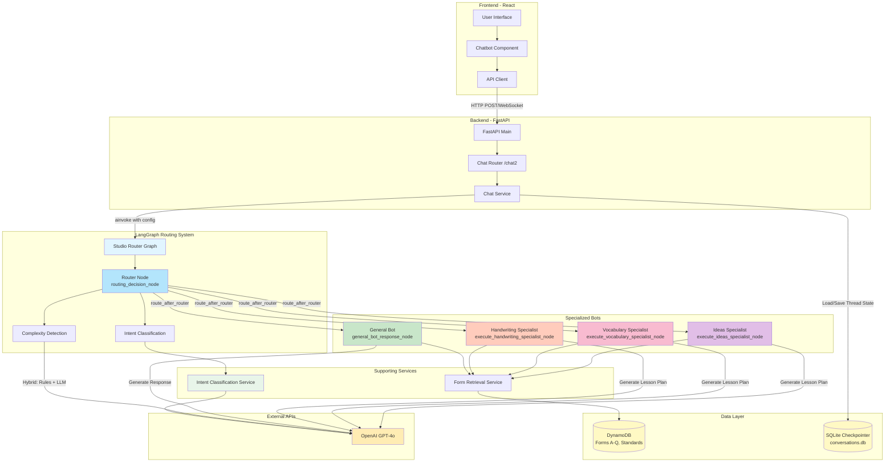

---

## System Flow Diagram

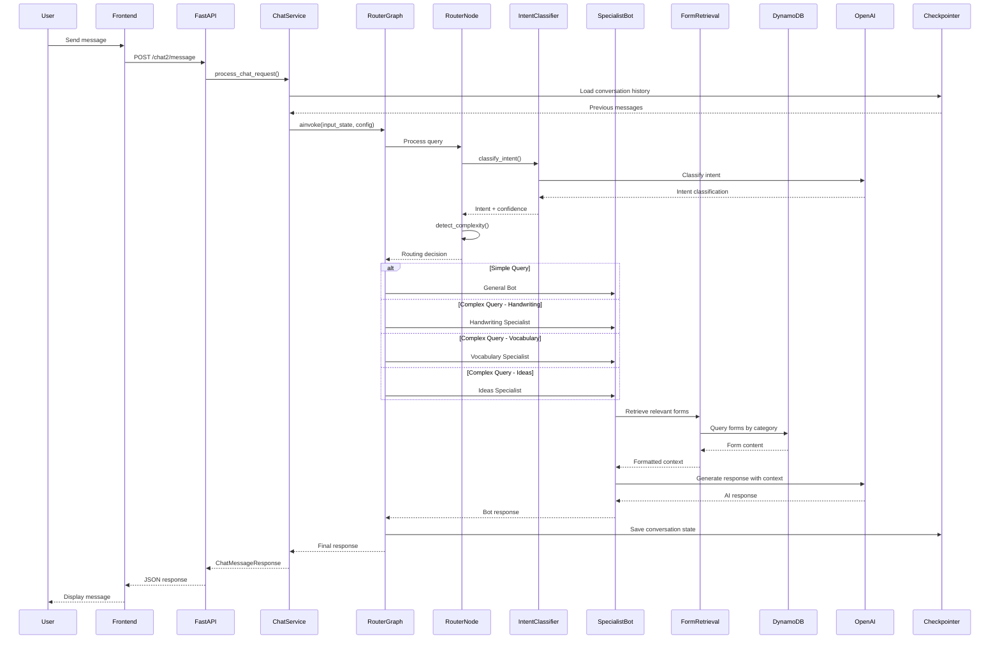

---

## Detailed Component Architecture

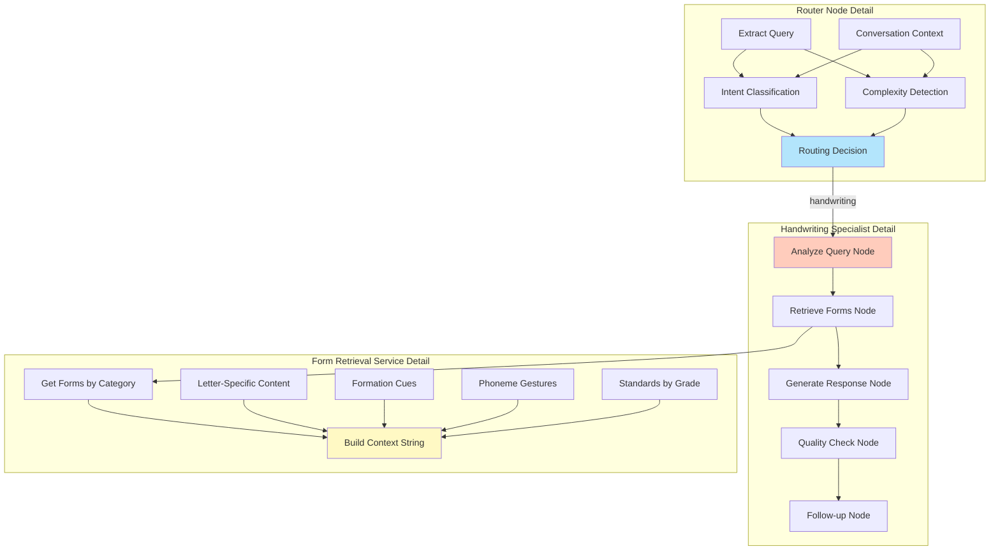

---

## Data Flow Architecture

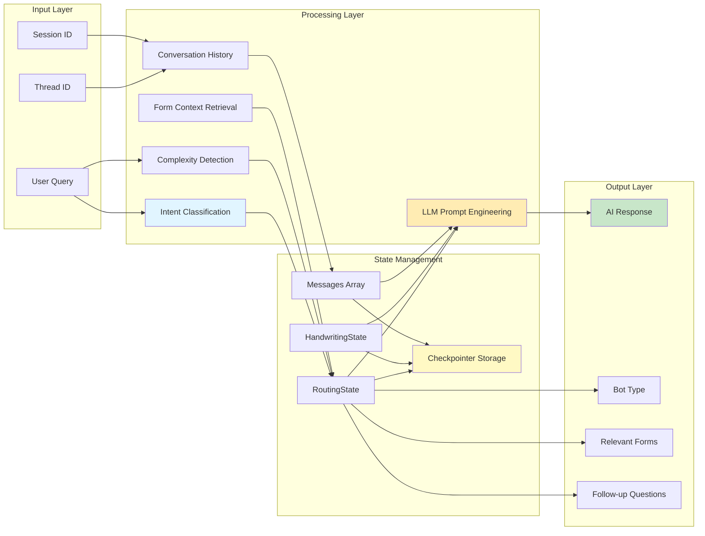

---

## Technology Stack

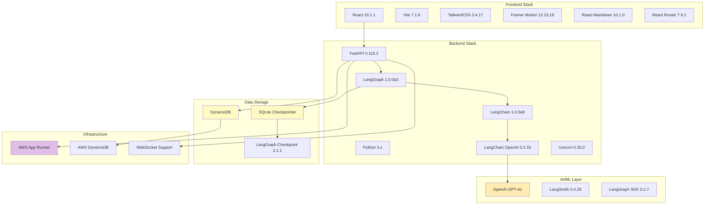

---

## Routing Logic Flow

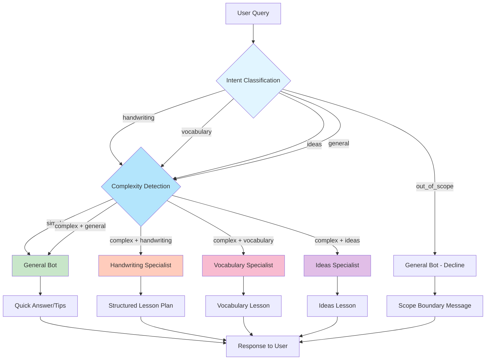

---

## Conversation Memory Architecture

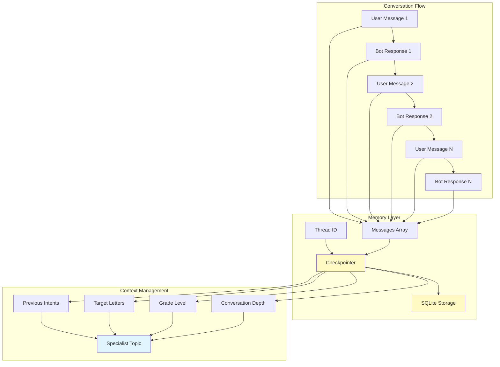

---

## State Schema Architecture

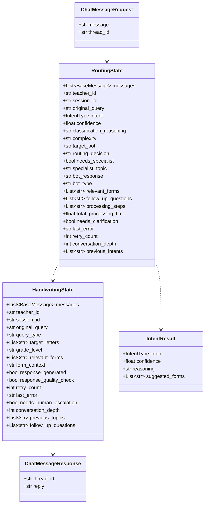

---

## Form Data Structure

```mermaid
graph TB
    subgraph "Educational Forms A-Q"
        FA[Forms A-H: Handwriting]
        FB[Forms I-L: Vocabulary]
        FC[Forms M-Q: Ideas]
    end

    subgraph "Handwriting Forms A-H"
        HA[Form A: Objectives]
        HB[Form B: Structure]
        HC[Form C: Template]
        HD[Form D: Activities]
        HE[Form E: Evidence-Based Practices]
        HF[Form F: Sequence Verbal Cues]
        HG[Form G: Phoneme Gestures]
        HH[Form H: Adaptations]
    end

    subgraph "Vocabulary Forms I-L"
        VI[Form I: Structure]
        VJ[Form J: Template]
        VK[Form K: Activities]
        VL[Form L: Modifications]
    end

    subgraph "Ideas Forms M-Q"
        IM[Form M: Genre Elements]
        IN[Form N: Structure]
        IO[Form O: Template]
        IP[Form P: Activities]
        IQ[Form Q: Modifications]
    end

    subgraph "Standards Data"
        SP[Pre-K Standards]
        SK[Kindergarten Standards]
        S1[1st Grade Standards]
    end

    subgraph "DynamoDB Storage"
        DB[(DynamoDB Table)]
        IDX1[CategoryIndex]
        IDX2[TypeIndex]
    end

    FA --> HA
    FA --> HB
    FA --> HC
    FA --> HD
    FA --> HE
    FA --> HF
    FA --> HG
    FA --> HH

    FB --> VI
    FB --> VJ
    FB --> VK
    FB --> VL

    FC --> IM
    FC --> IN
    FC --> IO
    FC --> IP
    FC --> IQ

    HA --> DB
    HB --> DB
    HC --> DB
    HD --> DB
    HE --> DB
    HF --> DB
    HG --> DB
    HH --> DB
    VI --> DB
    VJ --> DB
    VK --> DB
    VL --> DB
    IM --> DB
    IN --> DB
    IO --> DB
    IP --> DB
    IQ --> DB
    SP --> DB
    SK --> DB
    S1 --> DB

    DB --> IDX1
    DB --> IDX2

    style DB fill:#fff9c4
    style HA fill:#ffccbc
    style VI fill:#f8bbd0
    style IM fill:#e1bee7
```

---

## Deployment Architecture

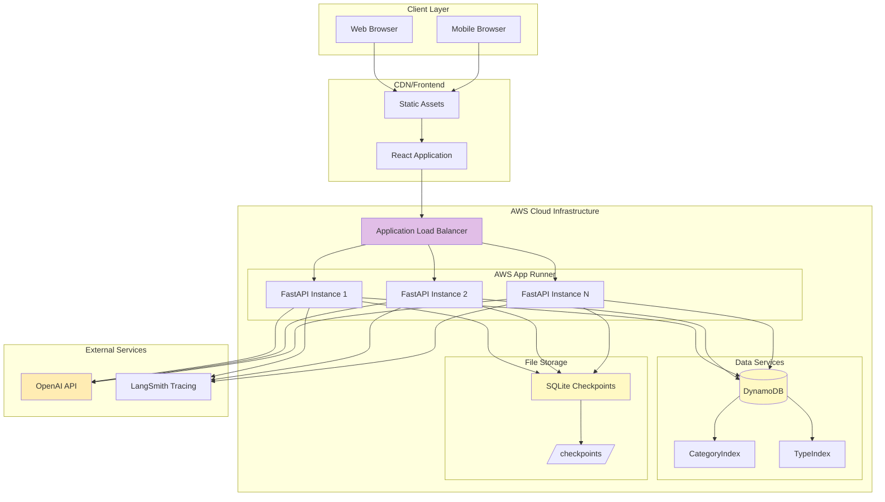

---

## API Endpoints Architecture

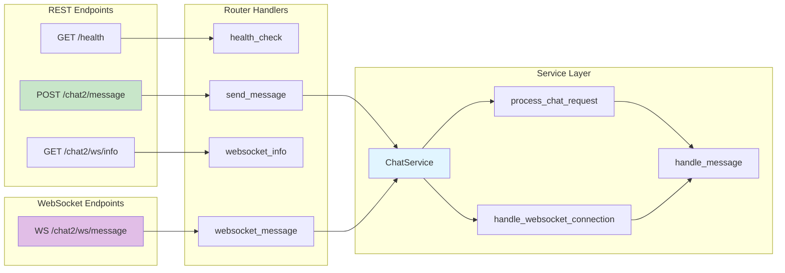

---

## Key Design Principles

### 1. **Router-First Architecture**
- All queries pass through a dedicated routing node
- Intelligent intent classification using GPT-4o
- Complexity detection determines specialist vs. general response
- Transparent handoffs between specialists

### 2. **Conversation Memory**
- Persistent conversation history using SQLite checkpointer
- Thread-based context management
- Cross-bot context sharing (handwriting → vocabulary transitions)
- Automatic message history retrieval via thread_id

### 3. **Domain Specialization**
- **General Bot**: Quick answers, greetings, simple literacy guidance
- **Handwriting Specialist**: Structured 5-part lesson plans (Forms A-H)
- **Vocabulary Specialist**: Sentence structure lessons (Forms I-L)
- **Ideas Specialist**: Creative writing lessons (Forms M-Q)

### 4. **Form-Based Content Retrieval**
- Educational content stored in DynamoDB
- 17 forms (A-Q) containing structured lesson content
- Dynamic retrieval based on intent and query type
- Grade-level standards integration

### 5. **Scalable LangGraph Design**
- StateGraph for flow control
- Asynchronous node execution
- Conditional routing logic
- Checkpointer for state persistence
- Memory-efficient context management

---

## Performance Considerations

### Caching Strategy
- Forms cached in DynamoDB with indexed queries
- Conversation state persisted in SQLite
- Thread-based memory reduces redundant LLM calls

### Optimization Techniques
- Async/await throughout the pipeline
- Thread pool execution for blocking operations
- Selective form retrieval (only relevant categories)
- Context string length limits (2000-4000 chars)
- Parallel tool calls where possible

### Scalability
- Stateless FastAPI instances
- Thread-safe SQLite checkpointer
- AWS App Runner auto-scaling
- DynamoDB indexed queries for fast retrieval

---

## Security & Error Handling

### Security Measures
- Environment variable configuration
- Pydantic schema validation
- Secret management for API keys
- CORS configuration for frontend access

### Error Handling
- Try-catch blocks in all async nodes
- Fallback responses for LLM failures
- Retry logic with exponential backoff
- Graceful degradation for missing forms

---

## Future Architecture Enhancements

1. **Multi-Tenant Support**: Teacher-specific form customization
2. **Real-Time Streaming**: Token-by-token response streaming
3. **Analytics Dashboard**: Usage patterns and bot performance
4. **A/B Testing**: Compare routing strategies
5. **Cache Layer**: Redis for frequently accessed forms
6. **Voice Input**: Speech-to-text integration
7. **PDF Export**: Export lesson plans as formatted PDFs

---

## Configuration Files

### Backend Configuration
- `backend/app/config.py`: Environment variables, API keys
- `backend/langgraph.json`: LangGraph Studio configuration
- `backend/requirements.txt`: Python dependencies
- `backend/.env.local`: Local environment variables

### Frontend Configuration
- `frontend/package.json`: NPM dependencies
- `frontend/vite.config.js`: Build configuration
- `frontend/tailwind.config.js`: Styling configuration
- `frontend/.env`: API base URL configuration

---

## Development & Debugging

### LangGraph Studio Integration
```json
{
  "$schema": "https://langgra.ph/schema.json",
  "dependencies": ["."],
  "graphs": {
    "complete_routing": "app.chatbot.studio.studio_router:studio_router"
  },
  "env": ".env.local"
}
```

### Logging & Monitoring
- Print statements throughout graph execution
- LangSmith tracing integration
- Conversation depth tracking
- Processing time metrics

---

## Repository Structure

```
edtech-chatbot/
├── backend/
│   ├── app/
│   │   ├── chatbot/
│   │   │   ├── routing/
│   │   │   │   ├── router_state.py
│   │   │   │   └── router_nodes.py
│   │   │   ├── specialists/
│   │   │   │   ├── general/
│   │   │   │   │   └── bot.py
│   │   │   │   ├── handwriting/
│   │   │   │   │   ├── nodes.py
│   │   │   │   │   ├── prompts.py
│   │   │   │   │   └── state.py
│   │   │   │   ├── vocabulary/
│   │   │   │   └── ideas/
│   │   │   └── studio/
│   │   │       └── studio_router.py
│   │   ├── routers/
│   │   │   └── chat.py
│   │   ├── services/
│   │   │   ├── chat_service.py
│   │   │   ├── form_retrieval.py
│   │   │   └── intent_classifier.py
│   │   ├── schemas/
│   │   │   ├── chat.py
│   │   │   └── intent.py
│   │   ├── config.py
│   │   ├── database.py
│   │   └── main.py
│   ├── checkpoints/
│   │   └── conversations.db
│   ├── requirements.txt
│   └── langgraph.json
└── frontend/
    ├── src/
    │   ├── api/
    │   │   ├── client.js
    │   │   └── index.js
    │   ├── components/
    │   │   ├── Chatbot.jsx
    │   │   └── MarkdownRenderer.jsx
    │   ├── pages/
    │   │   └── AITeachingAssistant.jsx
    │   ├── App.jsx
    │   └── main.jsx
    └── package.json
```

---

## Conclusion

This architecture provides a robust, scalable, and intelligent AI teaching assistant that leverages **LangGraph's state management** and **LangChain's LLM orchestration** to deliver domain-specific educational content. The router-first design ensures queries are handled by the most appropriate specialist, while the persistent conversation memory enables natural, context-aware interactions across multiple turns.